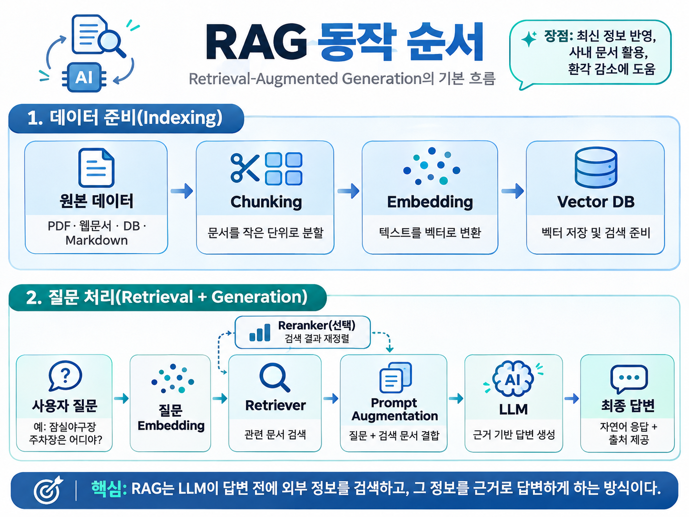

**RAG란?**

RAG(Retrieval-Augmented Generation)는 검색 증강 생성이라고 하며, LLM이 답변을 생성하기 전에 외부 데이터에서 관련 정보를 검색하고, 검색된 정보를 근거로 답변을 하도록 하는 기술입니다.

외부 데이터를 조회하는 점을 통해 LLM의 한계점이었던, 최신 지식을 항상 보유하지 않고 특화된 도메인 지식을 가지고 있지 않았던 한계를 보완할 수 있습니다.

> **RAG 동작**

**(1) 데이터 저장 (Indexing)**

먼저 준비된 자료들을 청크라는 단위로 분할을 하고, 임베딩을 통해 벡터로 변환한 뒤 벡터 DB에 저장을 합니다.

**(2) 질문 처리 (Retrieval + Generation)**

사용자 질문이 들어오면 해당 질문을 임베딩하여 벡터로 변환하고, 해당 질문에 연관성이 높은 데이터를 검색한 후, 검색된 데이터와 사용자 질문을 함께 LLM에 전달하여 해당 데이터를 근거로 최종 답변을 생성합니다.

**Tip)**

- **청킹(Chunking)**: 긴 문서를 검색하기 쉽도록 작은 단위로 나누는 과정
- **임베딩(Embedding)**: 텍스트의 의미를 숫자 배열(벡터)로 변환하여, 컴퓨터가 텍스트 간 의미적 유사도를 비교할 수 있도록 하는 과정
- **인덱싱(Indexing)**: 데이터를 효율적으로 검색할 수 있도록 가공하여 저장하는 과정

> **기존 검색 과정과의 차이점**

키워드 기반 검색의 대표적인 알고리즘으로는 BM25가 있습니다. BM25는 검색어가 문서에 등장하는 빈도, 해당 단어의 희소성, 문서 길이 등을 고려하여 관련성 점수를 계산하는 방식입니다.

반면 임베딩 기반 검색은 검색어와 문서를 임베딩 모델을 통해 고차원 벡터로 변환한 뒤, 벡터 간 유사도를 계산하여 의미적으로 관련성이 높은 문서를 찾는 방식입니다.

즉, 키워드 기반 검색은 검색어와 문서에 포함된 단어의 일치도를 중심으로 검색하는 반면, 임베딩 기반 검색은 검색어에 오타가 있거나 서로 다른 단어를 사용하더라도 의미가 유사하다면 관련 문서를 검색할 수 있다는 차이가 있습니다.

**Tip)**

- BM25: 문서의 관련성 점수를 계산하는 랭킹 알고리즘
- Embedding: 텍스트를 벡터로 변환하는 기술
- Cosine Similarity: 벡터 간 유사도를 계산하는 방법
- RRF: 서로 다른 검색 결과의 순위를 결합하는 알고리즘

> **청킹, 임베딩과 벡터 스토어의 각각의 역할**

1. 청킹

긴 문서를 검색에 적합한 작은 단위인 `청크`로 나누는 과정으로, 필요한 정보가 포함된 부분을 검색하고, LLM에 전달할 문맥의 범위를 적절히 조절하기 위함입니다.

Tip) 청크를 너무 작게 나누면 문맥이 끊어질 수 있고, 너무 크게 나누면 서로 다른 주제가 섞여 검색 정확도가 떨어질 수 있습니다.

1. 임베딩

텍스트들을 의미적 특징을 담은 고차원 숫자 벡터로 변환하는 과정을 의미합니다.

Tip) 임베딩되면, 문장의 의미적 특징이 벡터에 반영되므로, 서로 다른 단어를 사용하더라도 의미가 유사한 문장들은 벡터 공간에서 가까운 위치에 표현될 수 있습니다.

1. 벡터 스토어

임베딩하여 생성된 벡터와 관련된 데이터를 저장하고, 사용자의 질문 벡터와 유사도가 높은 문서를 효율적으로 검색하는 역할을 합니다.

Tip) 벡터 스토어 종류에는 대표적으로 `pgvector`, `Pinecone`, `Milvus`, `Qdrant`, `Weaviate`가 있습니다.

> **RAG를 적용하더라도 남는 문제**

RAG를 적용하더라도 기존 데이터가 정제되지 않은 상태라면 임베딩을 위한 데이터 전처리 과정이 필요하며, 청킹 전략에 따라 중요한 문맥이 손실되어 검색 정확도가 떨어질 수 있습니다.

또한 관련 문서를 정확히 검색하더라도 LLM이 해당 내용을 잘못 해석하거나 문서에 없는 정보를 생성하는 할루시네이션 문제는 여전히 발생할 수 있습니다.
