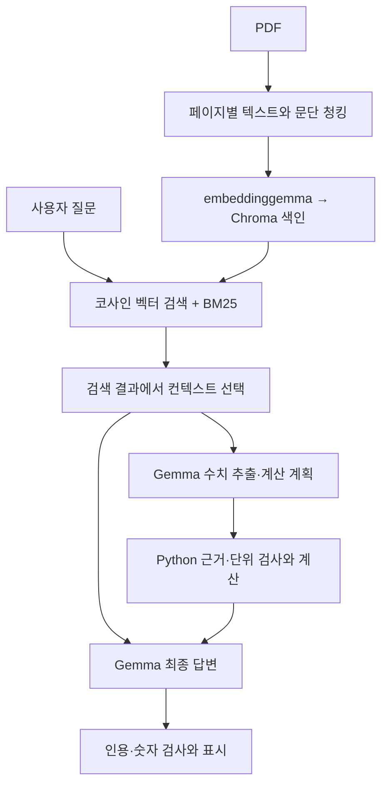

# 2주차: 공개 보도자료로 구현한 RAG와 오류 분석

작성자: **kwon-s-w**

공개 PDF에서 근거를 검색하고 답변하는 RAG를 직접 구성했다. 일부 합계 계산은 맞았지만, 답변 누락과 잘못된 계산 대상 선택이 남았다. **최종 실행은 10문항 중 9문항이 처리 완료됐으며, 전체 정확도 향상은 입증하지 못했다.**

## 목차

1. [RAG 정리](#1-rag-정리)
2. [데이터 출처와 선택 이유](#2-데이터-출처와-선택-이유)
3. [구성 방식과 처리 흐름](#3-구성-방식과-처리-흐름)
4. [모델과 실행 설정](#4-모델과-실행-설정)
5. [실행 방법](#5-실행-방법)
6. [질문과 실행 결과](#6-질문과-실행-결과)
7. [결론과 남은 질문](#7-결론과-남은-질문)
8. [참고 자료](#8-참고-자료)

## 1. RAG 정리

### 1.1 RAG는 LLM의 어떤 한계를 보완하며, 컨텍스트는 왜 중요한가?

LLM은 학습하지 않은 최신 정보나 특정 문서의 세부 내용을 정확히 답하기 어렵고, 없는 내용을 만들어낼 수 있다. **RAG는 외부 자료에서 질문에 필요한 근거를 찾아 질문과 함께 제공해 이러한 한계를 보완한다.**

컨텍스트는 모델이 답변할 때 참고하는 자료다. **질문에 맞고 답에 필요한 정보가 충분한 컨텍스트**를 제공해야 근거 있는 답변을 기대할 수 있다.

### 1.2 문서 준비 → 검색 → 컨텍스트 구성 → 답변 생성은 어떻게 이어지는가?

| 단계 | 역할 |
|---|---|
| 문서 준비 | 문서를 읽고 청크로 나눈 뒤 검색할 수 있도록 저장한다. 벡터 검색에는 임베딩을 만든다. |
| 검색 | 사용자 질문과 관련된 청크를 찾는다. |
| 컨텍스트 구성 | 검색한 청크를 질문과 함께 모델의 입력에 넣는다. |
| 답변 생성 | 모델이 제공된 자료를 참고해 답하고, 확인할 수 없는 내용은 정보 부족으로 안내한다. |

### 1.3 키워드 기반 검색과 임베딩 기반 검색은 어떻게 다른가?

| 방식 | 사용하는 단서 | 특징 |
|---|---|---|
| 키워드·BM25 | 단어/표현의 일치와 빈도 | 고유명사·명칭 검색에 유용하며 표현이 다른 질문은 놓칠 수 있다. |
| 임베딩·벡터 검색 | 학습된 벡터 공간에서의 유사성 | 다른 표현으로 적힌 관련 자료를 찾는 데 유용하지만 유사성은 정답 확률이 아니다. |

### 1.4 청킹, 임베딩과 Vector Store는 각각 어떤 역할을 하는가?

- **청킹:** 문서를 검색하기 적절한 작은 단위로 나눈다.
- **임베딩:** 문서 청크와 질문을 검색용 숫자 벡터로 표현한다.
- **Vector Store:** 벡터와 연결된 문서를 저장하고, 질문 벡터와 유사한 항목을 찾는다.

### 1.5 RAG를 적용해도 어떤 문제가 남을 수 있는가?

- 필요한 자료를 검색하지 못하거나, 답에 필요한 정보가 일부 빠질 수 있다.
- 근거가 있어도 모델이 잘못 해석하거나 계산 대상을 혼동할 수 있다.
- 긴 컨텍스트의 일부 내용을 놓치거나, 답할 수 있는데도 정보 부족이라고 안내할 수 있다.
- 문서 처리·검색·생성 단계가 추가되면서 실행 시간과 구성의 복잡성이 늘어날 수 있다.

## 2. 데이터 출처와 선택 이유

- 자료: 국토교통부, **「수도권 ‘신규택지 10.4만호’ 신속 공급」**, 2026-10-29, PDF 6쪽.
- 공개 출처: [국토교통부 게시물](https://www.molit.go.kr/USR/NEWS/m_71/lst.jsp/dtl.jsp?id=95092536&lcmspage=1), [대한민국 정책브리핑 재게시·PDF](https://www.korea.kr/briefing/pressReleaseView.do?newsId=156786992).
- 사용 파일: `261029(보도자료) 수도권 ‘신규택지 10.4만호’ 신속 공급(공공택지조사개발과).pdf`.
- 선택 이유: 한국어 공개 문서이며 지구별 공급량·교통계획·추진 목표가 있어 사실 검색과 계산을 함께 시험하기 좋다. 확정 가격·입주일·청약 자격·특별공급 배정은 없어 정보 부족 처리도 시험할 수 있다.
- 원본 식별 SHA-256: `9e84959b5991a6b5cedce266d57424579f8ac2c1e9b045cac06f0550b3446d41`.

원본 PDF는 공개 출처에서 받을 수 있다. 제출본에는 PDF 자체를 넣지 않았고, 실행 로그 사본의 담당자 성명·연락처는 가렸다. 청크 ID·쪽수·질문·수치·답변과 오류는 보존했다. 가림 범위와 원본/제출 파일 해시는 [정리 기록](results/provenance.json)에 남겼다.

## 3. 구성 방식과 처리 흐름

**선택한 방식: 직접 설치·구성.** Colab 가상 컴퓨터에 Ollama와 Chroma를 설치했다.

**선택 이유:** 문서 준비 → 검색 → 답변 생성의 각 단계를 직접 연결하고, 설정과 실제 검색 결과를 코드·로그로 확인하기 위해서다.

| 구분 | 담당한 부분 |
|---|---|
| Python 코드로 직접 구성 | 문서 불러오기, 청킹 규칙, 페이지·청크 ID 관리, 검색 설정, 컨텍스트·프롬프트 구성, 계산·검증, 실행 기록 저장 |
| 라이브러리·모델이 처리 | pypdf의 텍스트 추출, Chroma의 벡터 저장·검색, BM25 검색 점수 계산, Ollama를 통한 embeddinggemma 임베딩과 Gemma 답변 생성 |
| Colab이 제공 | Python 실행 환경과 할당된 CPU·메모리·GPU 자원 |

Colab은 코드를 실행할 환경으로 사용했으며, 관리형 RAG 서비스를 이용해 문서 연결과 검색·생성 구성을 맡긴 것은 아니다.



1. **문서 준비:** pypdf로 페이지별 텍스트를 추출하고 문단 우선으로 분할한다. 청크마다 문서명·쪽수·ID를 보관한다. 이번 실행은 29개 청크다.
2. **검색:** 실제 실행에서는 벡터 검색과 BM25를 사용하고 RRF로 순위를 결합했다. 설정값은 아래 표에 기록했다.
3. **수치·계산:** Gemma가 수치와 계산 대상을 고르면 Python이 근거·단위를 검사하고 계산한다.
4. **답변 생성:** 질문·검색 원문·확인한 수치·계산 결과를 detailed 지시와 함께 Gemma에 전달한다.
5. **출력:** 인용·숫자 검사를 통과한 문장, Python 계산, 정보 부족 안내를 표시한다. **계산 대상의 적합성까지 검사하지 못해 잘못된 계산도 표시됐다.**

코드 작성과 결과 정리에 AI 도구를 활용했다. 실제 실행은 Colab에서 수행했고, 제출 결과는 실행 로그와 PDF를 대조해 정리했다.

## 4. 모델과 실행 설정

| 항목 | 최종 Gemma 실행 설정 |
|---|---|
| 환경 | Google Colab, Python 3.13.16, Tesla T4, Ollama 0.40.15 |
| 생성 모델 | `gemma3:4b`, 실행 메타데이터 3.9B, Q4_K_M |
| 임베딩 | `embeddinggemma` / 실행 태그 `embeddinggemma:latest`, 768차원 |
| Vector Store | Chroma 1.5.9, cosine |
| 키워드 검색 | rank-bm25 0.2.2, 단어와 한국어 문자 2~3그램 |
| 청킹 | 문단 우선, 긴 본문 최대 900자; 앞 문장 겹침 최대 120자 추가 가능 |
| 검색 후보 | 벡터 최대 6개 + BM25 최대 6개 |
| 순위 결합 | RRF 상수 60 |
| 최종 컨텍스트 | 최대 8청크, ID·쪽수 표시와 구분자를 포함한 약 4,200자 예산 |
| 샘플링 | temperature=0, seed=42, num_ctx=8192 |
| 생성 상한 | 설정 파일 기본 2048; 패치의 실제 추출 1600→최대2048, 최종 1500→최대2012, 계산 보완 600→최대1112 |
| 재시도 | 각 구조화 생성의 출력 한도/JSON 오류 시 최대 한 번. 실제 요청값은 calls.jsonl 기준 |
| 계산 | Decimal, 비율 소수 둘째 자리 ROUND_HALF_UP. 입력/연산 선택은 모델 판단 |
| 실험 질문 | 기존 개발용 10문항, 답 확인 가능 5개 + 요청 핵심값 미기재 5개 |

모델 digest와 환경 상세는 [environment.json](results/gemma/environment.json), 설정은 [config.json](results/gemma/config.json), 실제 프롬프트는 [prompt_templates.json](results/gemma/prompt_templates.json)에 있다. 모델 자체의 최대 컨텍스트와 이번 실행의 `num_ctx=8192`는 구분했다.

## 5. 실행 방법

Google Colab에서 GPU 런타임을 선택한다. [공개 출처](https://www.korea.kr/briefing/pressReleaseView.do?newsId=156786992)의 같은 PDF와 [rag_experiment.py](src/rag_experiment.py)를 PC에 준비한다.

새 코드 셀에서 다음을 실행하고 `rag_experiment.py`를 업로드한다.

```python
from google.colab import files
uploaded_code = files.upload()
```

다음 코드 셀에서 실행한다. 중복 업로드로 파일명에 번호가 붙었다면 실제 저장된 파일명을 사용한다.

```python
%run rag_experiment.py
```

패키지와 Ollama 모델 준비 후 PDF 업로드 창에서 같은 PDF 한 개를 선택한다. 10개 질문 실행 후 결과 ZIP이 다운로드된다. 모델 다운로드와 GPU 준비 시간이 필요하며, 환경과 모델 응답에 따라 결과가 달라질 수 있다.

실제 제출 로그는 **기존 노트북의 준비 셀과 [실행 당시 패치](src/applied_cell_patch.py)**를 사용한 결과다. `rag_experiment.py`는 이를 순서대로 합친 실행용 소스이며 통합 후 모델을 다시 호출하지 않았다. 통합 소스의 문법·구성과 기록의 일관성만 오프라인 검사했다.

Gemma 실행에는 외부 모델 API 키가 필요 없다. 재실행 로그에 원본 담당자의 연락처가 포함될 수 있으므로 공개 제출 시 가려야 한다.

## 6. 질문과 실행 결과

- [질문 10개와 예상 답변 표](results/questions_and_expected.md)
- [각 질문의 실제 검색 원문·페이지·최종 답변·수동 검토](results/review.md)
- [원 응답과 단계별 호출 로그](results/gemma/calls.jsonl)
- [검색·추출·계산·최종 출력 전체 기록](results/gemma/results.json)

예상 답변은 평가에만 사용했고, 검색·생성에는 질문과 실제 검색 자료만 전달했다. 아래 판정은 전체 정답률 대신 요구사항 충족과 오류를 구분한 수동 검토다.

| 질문 | 판정 | 관찰 |
|---|---|---|
| Q1 | 미충족 | 필요한 수치 근거가 검색됐지만 질문을 반복하고 등록되지 않은 계산 ID를 반환했다. 최종 사실 답변과 계산이 없다. |
| Q2 | 부분 충족 | 18,500호 합계는 정확하다. 교통계획 근거도 검색됐으나 정보 부족으로 처리했다. 정답 내용의 합계 문장도 발췌 불일치로 보류됐다. |
| Q3 | 부분 충족·주의 | 18,600호 계산과 구리 사업 전환 설명은 확인된다. 기존 고양 지구와 확장 지구의 구분이 흐리고, 답한 내용을 다시 정보 부족이라고 하는 모순이 있다. 불필요한 계산 ID 인용도 붙었다. |
| Q4 | 미충족 | 직원·가족 조사와 거래 선별 근거가 모두 검색됐지만 답변과 22.42% 계산을 완성하지 못했다. 원 응답은 질문을 설명문으로 반복한다. |
| Q5 | 생성 실패 | 일정·허가구역 근거가 검색됐다. 최종 생성이 두 번 모두 출력 한도로 끝나 표시 답변을 만들지 못했다. 내부에 생성된 계산 1건은 일정 질문에 부적절하다. |
| Q6 | 정보 부족 처리·일부 미흡 | 확정 분양가가 없어 계산 불가능하다고 안내했다. 실제 84㎡ 공급량도 없다는 점을 별도로 밝히면 더 완전하다. |
| Q7 | 정보 부족 처리·일부 미흡 | 확정 청약·준공·입주일을 지어내지 않았다. 2030년 착공 목표를 입주일로 대체할 수 없다는 설명은 빠졌다. |
| Q8 | 오류 포함 | 자격 기준 부족은 안내했지만 총 공급량을 청약 가능 호수로 잘못 명명하고 불필요한 합계·정렬을 표시했다. 가구의 청약 가능 여부는 판단할 수 없다. |
| Q9 | 정보 부족 처리·일부 미흡 | 위법 확정 건수가 없다고 안내했다. 선별과 위법 확정의 구분 및 도시별 분모도 없다는 설명은 보완할 여지가 있다. |
| Q10 | 오류 포함 | 전체와 부분 물량을 중복 합산했고, 관련 없는 두 수치로 382.35%를 신혼부부 배정 비율이라고 표시했다. 유형별·특별공급 물량은 원문에 없다. |

### 대표 결과

- **Q2:** 12,000+6,500=18,500호 계산은 맞았다. 교통계획의 근거는 검색됐지만 비교 설명은 정보 부족으로 처리했다. 올바른 합계 문장도 발췌 불일치로 보류됐다.
- **Q6:** 확정 분양가가 없어 계산할 수 없다고 안내했다. 실제 84㎡ 공급량도 없다는 점을 별도로 설명할 필요가 있다.
- **Q10:** 10.4만호와 7.67만호를 더해 18.07만호라고 표시했고, 10.4만호/2.72만호를 신혼부부 배정 비율로 잘못 명명했다. 산술 수행과 올바른 계산 대상 선택이 다름을 보여준다.

### 측정값

| 항목 | 값과 해석 |
|---|---|
| 처리 완료 | 9/10. 정답률이 아니다. |
| 실패 | Q5 최종 생성의 출력 한도. 재시도 후에도 실패. |
| 모델 생성 호출 | 27회: 수치 추출 10, 최종 생성 11, 계산 계획 보완 6 |
| 생성 토큰 | 입력 44,952 + 출력 12,767 = **57,719**. 실패·재시도 포함 |
| 질문 임베딩 | 10회, 입력 690토큰. 생성 토큰과 별도 집계 |
| 계산 기록 | 7건. Q5 실패 전 내부 계산 1건을 포함하므로 화면에 표시된 계산은 6건 |
| 사실 문장 보류 | 10건. 모든 보류가 정답 차단이나 올바른 오답 차단이라고 단정할 수 없음 |
| 질문 처리 합계 | 약 **365.73초(6분 6초)**. 이번 결과 ZIP 기준, 설치·색인 생성 제외 |

## 7. 결론과 남은 질문

**외부 근거 검색과 Python 계산을 연결했지만, 정확한 답변을 보장하지 못했다.** Q1~Q5의 평가용 핵심 문구 28개가 실제 선택 컨텍스트에 모두 들어 있었다. 이 문구 포함 검사는 일반적인 검색 Recall이나 의미적 충분성 지표는 아니지만, 해당 문항 실패를 모두 검색 누락 탓으로 설명할 수 없다는 근거가 된다.

1. 모델이 질문을 반복하거나 수치·연산 대상을 잘못 선택했다.
2. 인용 검사는 실제 발췌 불일치를 찾았지만 정답 내용이 담긴 문장도 최종 출력에서 빠졌다.
3. 계산 결과를 별도로 표시하는 경로는 의미 검증을 거치지 않아, 관련 없는 비율과 중복 합산도 화면에 남았다.
4. 여러 부분을 동시에 수정하고 같은 개발 질문으로 반복 확인했으므로, 개별 기법의 효과나 새 질문에서의 일반화 성능을 입증하지 못했다.

다음 수업에서 확인하고 싶은 질문은 **검색 근거가 충분한데도 답하지 못할 때 모델의 이해 문제와 프롬프트·후처리 문제를 어떻게 분리해 평가할 것인가**, 그리고 **계산에 사용하는 숫자의 대상·전체/부분 관계를 어떻게 검증할 것인가**이다. 한 조건씩 바꾸고 새 평가 질문을 사용하는 비교가 필요하다.

발표는 [약 3~4분 대본](PRESENTATION.md)에 정리했다.

## 8. 참고 자료

- [Stanford CS25 V3: Retrieval Augmented Language Models](https://www.youtube.com/watch?v=mE7IDf2SmJg): 과제 참고 강의.
- [RAG 원 논문](https://arxiv.org/abs/2005.11401): 내부·외부 지식 결합.
- [Microsoft 문서 청킹 지침](https://learn.microsoft.com/en-us/azure/search/vector-search-how-to-chunk-documents).
- [Chroma 설정](https://cookbook.chromadb.dev/core/configuration/).
- [Lost in the Middle](https://arxiv.org/abs/2307.03172): 긴 컨텍스트의 정보 활용 문제.
